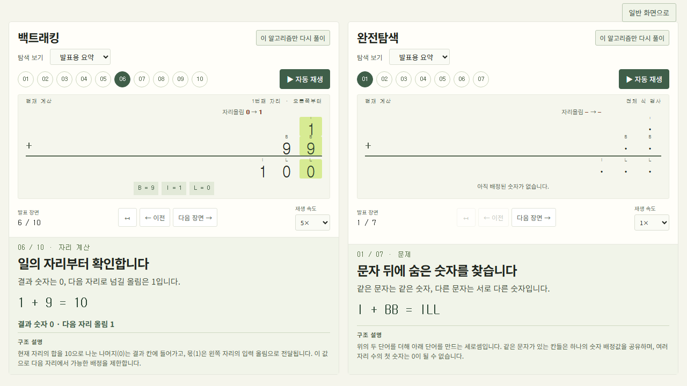

# 복면산 탐구실

알고리즘 13반 기말발표 주제 **B04 복면산**을 위한 교육용 웹 시뮬레이터입니다. 영문 수식을 입력하면 완전탐색 또는 백트래킹으로 해를 찾고, 실제 숫자 배정과 탐색 과정을 단계별로 보여 줍니다.

현재 버전은 **v0.1.0.0**입니다. 1차 앱 개발과 해당 범위의 기능 검증을 마쳤으며, 최종 PPT·영상 제작과 실제 발표 리허설은 후속 작업입니다. 최신 검증 범위는 [최종 종합 QA](docs/07-todo-list/final-qa-2026-11-14.md), 변경 내역은 [CHANGELOG](CHANGELOG.md)에서 확인할 수 있습니다.

## 주요 기능

- 빈 입력창에 수식을 직접 입력하거나 자리올림·여러 해·해 없음 등을 살펴볼 수 있는 예제 다섯 개 중에서 선택합니다.
- 완전탐색은 숫자를 배정한 뒤 전체 수식을 검사합니다. 백트래킹은 오른쪽 자리부터 검사하며 불가능한 후보를 제외합니다.
- 탐색 기록을 발표용 요약·단계별 요약·전체 기록으로 보고 자동 재생하거나 이전·다음 단계로 이동할 수 있습니다. 비교 모드에서는 두 알고리즘을 나란히 보고 각각 재생합니다.
- 문자별 숫자 배정, 해의 개수, 배정 시도·검사·가지치기 횟수와 실행 시간을 확인합니다.
- 탐색 종료 시 최종 숫자식과 문자별 배정을 확인하고 처음부터 다시 재생합니다. 해 없음·여러 해·제한 중단을 구분합니다.

## 제공 예제

예제 버튼은 수식만 채웁니다. **풀이 시작**을 눌러 선택한 알고리즘을 실제 실행합니다.

| 수식 | 살펴볼 내용 | 완료 시 해 개수 |
|---|---|---:|
| `I + BB = ILL` | 반복 문자, 자리올림, 가지치기와 복귀 | 1 |
| `SEND + MORE = MONEY` | 여러 자리 계산과 알고리즘별 탐색량 차이 | 1 |
| `A + A = A` | 같은 문자 재사용과 한 자리 0 허용 | 1 |
| `A + B = C` | 여러 해와 정답 선택 | 32 |
| `A + B = AA` | 전체 탐색 후 해 없음 | 0 |

## 입력 규칙

초기 버전은 `WORD + WORD = WORD` 형태의 **영문 단어 두 개를 더하는 수식**을 지원합니다. 소문자는 대문자로 변환되며 연산자 주변 공백은 허용됩니다. 서로 다른 문자는 최대 10개이고, 같은 문자는 같은 숫자, 다른 문자는 다른 숫자에 대응합니다. 여러 자리 단어의 첫 문자에는 0을 배정할 수 없습니다. 입력은 최대 128자입니다.

뺄셈·곱셈·나눗셈과 세 개 이상의 피연산자는 지원하지 않습니다. 데이터베이스, 사용자 계정과 외부 API는 사용하지 않습니다.

## 로컬 실행

Windows에서 Python 3.10 이상과 Git이 필요합니다. PowerShell에서 다음 명령을 실행하세요.

```powershell
git clone https://github.com/gu2417/Algorism_Cryptarithm.git
cd Algorism_Cryptarithm
git switch develop
py -3 -m venv .venv
.\.venv\Scripts\python.exe -m pip install -r requirements.txt
.\.venv\Scripts\python.exe app.py
```

브라우저에서 [http://127.0.0.1:5000](http://127.0.0.1:5000)을 엽니다. 서버를 종료하려면 실행 중인 터미널에서 `Ctrl+C`를 누릅니다. 5000번 포트가 이미 사용 중이라면 다른 포트로 실행할 수 있습니다.

```powershell
.\.venv\Scripts\python.exe -m flask --app app run --host 127.0.0.1 --port 5001
```

이 경우 [http://127.0.0.1:5001](http://127.0.0.1:5001)에 접속합니다. 가상환경이 이미 있다면 생성 단계를 건너뛸 수 있습니다.

## 사용 방법

1. 수식을 입력하거나 예제 버튼을 누릅니다.
2. 백트래킹, 완전탐색 또는 두 알고리즘 비교를 선택하고 **풀이 시작**을 누릅니다.
3. 기본 **발표용 요약**에서 다음 장면 버튼, 번호 목차, 좌우 방향키로 넘기거나 **자동 재생**을 누릅니다. 필요하면 탐색 보기를 바꿉니다.
4. 결과 영역에서 숫자 계산식과 문자별 배정, 탐색 통계를 확인합니다. 반환된 해가 여러 개라면 목록에서 선택할 수 있습니다.

| 탐색 보기 | 목적과 동작 |
|---|---|
| **발표용 요약** — 기본 | 실제 배정·실패·복귀·자리 계산·정답 등을 장면으로 설명합니다. 기본 예제는 4~10개 장면이며 계산식과 알고리즘 구조 설명을 제공합니다. 기본은 수동 진행이고 자동 재생은 1×에서 장면당 약 6초입니다. |
| **단계별 요약** | 실제 배정·검사·복귀 흐름을 자세히 확인합니다. 생략 구간과 중요한 전환 전에는 멈춰 다음 장면을 직접 확인할 수 있습니다. |
| **전체 기록** | 실제 실행 기록을 200개씩 조회합니다. 페이지 경계에서도 이전·다음·자동 재생을 이어가며 단계 번호와 마지막 단계 버튼으로 이동할 수 있습니다. |

비교 모드에서는 두 패널의 보기·단계·재생·속도를 각각 조작하고, **이 알고리즘만 다시 풀이**로 한쪽만 재계산할 수 있습니다. 최초 비교 풀이는 서버에서 두 알고리즘을 순차 실행합니다. **발표 화면**을 누르면 소개·입력·결과 목록을 접고 계산과 설명에 집중합니다.



## 실행 제한과 기록 보관

| 항목 | 기본값과 의미 |
|---|---|
| 계산 시간 | 알고리즘별 5초, PC 부하와 문제 크기에 따라 제한 중단 가능 |
| 반환 해 | 알고리즘별 최대 100개, 중단 시 발견한 개수만 제공 |
| 초기 기록 버퍼 | 80,000개 스냅샷, 웹 전체 보기의 재생 상한은 아님 |
| 전체 기록 보관 | 서버 프로세스별 최근 4개 실행, 실행별 10분 |

버퍼 상한 이후에도 계산과 요약 수집은 계속됩니다. 전체 보기는 동일한 실행 순서와 실제 종료 위치를 기준으로 버퍼 밖 이벤트를 복원합니다. 검증한 SEND 완전탐색은 **7,748,195번째 실제 종료 단계**까지 이동할 수 있습니다. 서버 재시작·기록 교체·보관 시간 만료 후에는 다시 풀이하면 됩니다.

시간 또는 해 개수 제한으로 중단되면 표시된 해의 개수는 하한이며, 0개여도 해가 없다고 확정하지 않습니다. 실행 시간에는 기록 생성 비용이 포함되고 HTTP 전송·브라우저 재생·요약 구성 시간은 제외되므로 순수 알고리즘 벤치마크로 해석하지 않습니다. API 계약과 복원 방식은 [아키텍처 문서](docs/03-architecture/README.md)를 참고하세요.

## 테스트

Python 의존성을 설치한 뒤 다음 명령으로 Core와 API 테스트를 실행합니다.

```powershell
.\.venv\Scripts\python.exe -m unittest discover -s tests -v
```

UI의 DOM 통합 테스트에는 Node.js 18 이상과 npm이 추가로 필요합니다.

```powershell
npm ci
npm test
```

PowerShell에서 `npm` 스크립트 실행이 차단된다면 `npm.cmd ci`, `npm.cmd test`를 사용할 수 있습니다.

UI 테스트도 실제 Flask 응답을 생성하므로 Python 의존성이 필요합니다. 기본 Python 경로는 `.venv/Scripts/python.exe`입니다. 다른 가상환경을 쓴다면 테스트 전에 경로를 지정합니다.

```powershell
$env:CRYPTARITHM_TEST_PYTHON=(Resolve-Path '.venv/Scripts/python.exe').Path
npm.cmd test
```

## 검증 현황과 남은 작업

2026-11-14 기준 Python **40개**, UI DOM 통합·회귀 **45개** 테스트가 통과했습니다. 실제 Chromium과 Flask 서버를 연결해 다섯 예제 × 세 모드의 **15개 풀이 흐름**, 발표 장면 **136개**, 단계별 요약 **356개**를 대조했습니다. 전체 기록 경계·끝까지 이동, 예제 전환, 독립 재생, 기록 만료·재시도와 1280×720 발표 화면·375×812 모바일 배치를 확인했습니다.

자세한 재현 조건·수정 전후 화면·원자료와 검증 한계는 [최종 종합 QA](docs/07-todo-list/final-qa-2026-11-14.md)에 있습니다. 다른 브라우저·실제 휴대기기·스크린리더·장시간 동시 부하·새 PC의 깨끗한 설치는 해당 검증에 포함하지 않았습니다.

후속 작업은 최종 PPT·영상 제작, 발표 PC와 프로젝터 확인, 실제 5분 리허설입니다. [작업 목록](docs/07-todo-list/README.md)과 [시연 순서](docs/07-todo-list/demo-draft.md)를 참고하세요.

## 프로젝트 구조

| 경로 | 역할 |
|---|---|
| `Core/` | 수식 모델, 제약 조건과 탐색 알고리즘 |
| `Feature/` | 풀이 실행, 탐색 기록 및 제한 관리 |
| `Module/` | 입력 검증과 Flask API |
| `templates/`, `static/` | 웹 화면과 스타일, 재생 기능 |
| `tests/` | Python 및 UI 테스트 |
| `docs/` | 요구사항, 설계, 검증과 작업 계획 |

## 문서

- [프로젝트 개요](docs/01-overview/README.md)
- [기능 요구사항](docs/02-features/README.md)
- [아키텍처와 API](docs/03-architecture/README.md)
- [파일 구조](docs/04-file-structure/README.md)
- [데이터 관리](docs/05-database/README.md)
- [UI/UX 설계](docs/06-uiux/README.md)
- [할 일 목록과 검증 보고서](docs/07-todo-list/README.md)
- [변경 이력](CHANGELOG.md)

개발은 구윤찬, 발표자료와 영상 제작은 송준영이 담당합니다.
